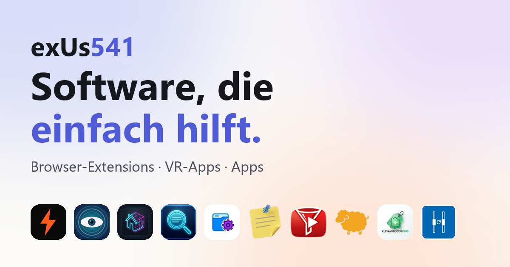

<div align="center">

# exUs541 · Portfolio

**Software, die einfach hilft.**

Browser-Extensions, VR-Apps, Android-Apps und PC-Anwendungen von exUs541, mit Stand, Fundorten und geplantem Termin.
Zweisprachig (DE/EN), statisch, ohne Build-Schritt.

[](https://exus541.github.io/portfolio/)


[](https://exus541.github.io/portfolio/)

</div>

## Überblick

Die Seite zeigt auf einen Blick, was es schon gibt, woran gearbeitet wird und wann es fertig wird. Läuft als statische Seite auf
[GitHub Pages](https://exus541.github.io/portfolio/), ohne Framework und ohne Build-Schritt.

- **Eine Datenquelle:** Alle Projekte stehen in [`projects.json`](projects.json). Karten, Filter, Zeitplan, Detailfenster und Kennzahlen rendern sich daraus.
- **Zweisprachig:** Deutsch und Englisch. Die Sprache folgt der Browser-Einstellung und lässt sich umschalten.
- **Filtern und suchen:** nach Art, Status und Tags, mit Direktlinks wie `?typ=extension` oder `#projekt-nestwise`.
- **Store-Links:** Chrome Web Store und Edge Add-ons. Wer die Seite in Edge öffnet, sieht den Edge-Link zuerst.
- **Gut zu finden und zu teilen:** Beschreibungen, Canonical-Links, Open Graph, strukturierte Daten (JSON-LD) und Sitemap.
- **Automatisch aktuell:** Neue Versionen der Extensions tragen sich per GitHub Actions in den Changelog ein.
- **Schlank und privat:** reines HTML, CSS und JavaScript, kein Tracking.

## Aufbau

```text
index.html, main.js     Startseite und ihre Logik (Filter, Suche, Detailfenster, Zeitplan)
site.js                 gemeinsam: Sprache DE/EN, Icons, Kopfzeile
style.css               gesamtes Design (Farben als Variablen ganz oben)
projects.json           Daten aller Projekte, Spenden- und Social-Links
changelog.json          Versionsverlauf der Extensions (wird automatisch gepflegt)
details/                Detailseiten der Extensions (details.css = gemeinsames Design)
roadmap.html            Feature-Wünsche der Extensions (Daten: roadmap-data.json, von Hand gepflegt)
feedback.html           Formulare für Ideen und Fehler (Formspree)
privacy.html            Datenschutzerklärung
extensions.html         Weiterleitung auf index.html?typ=extension (alte Links bleiben gültig)
assets/                 Logos, Vorschaubilder und Store-Screenshots
scripts/                Skripte der Automatisierung
.github/workflows/      GitHub Actions
```

## Lokal ansehen

```bash
python -m http.server 8765
```

Dann `http://localhost:8765` öffnen. Die Seite lädt `projects.json` per `fetch`, ein Doppelklick auf die Datei reicht nicht.

## Projekte pflegen

### Kleine Änderungen direkt auf GitHub

Stand, Termin oder Store-Link eines Projekts änderst du im Browser, ohne etwas zu installieren:

1. Öffne [`projects.json`](https://github.com/exUs541/portfolio/blob/main/projects.json) auf GitHub (eingeloggt) und klicke oben rechts auf das **Stift-Symbol** („Edit this file“).
2. Suche das Projekt (Strg+F nach dem Namen, z. B. `"id": "perspectives"`) und ändere die Felder (Beispiel unten).
3. Klicke auf **„Commit changes…“**, wähle **„Commit directly to the `main` branch“** und bestätige.
4. Nach etwa 1 bis 2 Minuten ist die Seite aktualisiert (im Browser einmal Strg+F5 drücken).

**Beispiel „App ist jetzt veröffentlicht“** (so wurde Perspectives umgestellt):

- `"status": "dev"` → `"status": "live"`
- `"stage": 3` → `"stage": 4`
- die Zeilen `"eta": …` und `"etaWhat": …` löschen (bei `live` gibt es keinen Termin mehr)
- bei `availability` den Link eintragen: `"url": "https://…"` und `"soon": true` entfernen
- optional `stageNote` anpassen, z. B. „Version 1.0 ist im Meta Horizon Store veröffentlicht.“

**Worauf achten:** Anführungszeichen und Kommas müssen stimmen (nach jedem Eintrag ein Komma, nur nach dem letzten nicht).
Ist die Seite danach leer oder fehlen Karten, steckt dort ein Fehler. Dann in GitHub unter **History** die letzte Änderung
öffnen und mit **„Revert“** zurücknehmen. So geht nie etwas verloren.

### Felder in `projects.json`

Neues Projekt = neuer Eintrag in `projects`, Änderung am Stand = Feld ändern.

| Feld | Bedeutung |
| --- | --- |
| `type` | Art, bestimmt Farbe, Filter und Abschnitt: `vr` (VR-App), `android` (Android-App), `game` (PC-Spiel), `desktop` (PC-Anwendung), `extension` (Browser-Extension). Eine Art erscheint auf der Seite, sobald es dazu ein Projekt gibt |
| `status` | `live` (verfügbar), `beta` (nutzbar, noch im Test), `dev` (in Entwicklung) |
| `stage` | Fortschrittsbalken: `1` Idee · `2` Entwicklung · `3` Test & Store · `4` Verfügbar |
| `eta` | geplanter Termin als Quartal `"2027-Q1"`, oder `"open"` (Termin offen). Bei `live` weglassen |
| `etaWhat` | wo es dann erscheint, z. B. „Meta Horizon Store“ |
| `availability` | Fundorte. `url: null` + `"soon": true` zeigt „… · geplant“ ohne Link. `kind`: `chrome`, `edge`, `github`, `web`, `play`, `meta`, `soon`. Wer die Seite im Edge-Browser öffnet, sieht den `edge`-Link zuerst. Auf den Kacheln zeigen `chrome` und `edge` nur kurze Buttons („Chrome“, „Edge“), der volle `label` steht im Tooltip und im Detailfenster |
| `stageNote`, `note` | Satz zum aktuellen Stand bzw. Hinweis (z. B. Geräte-Einschränkung) |
| `tags` | Stichwörter, nach denen man filtern und suchen kann, je Sprache gleich viele und in gleicher Reihenfolge, z. B. `"de": ["Fokus", "Spiel"], "en": ["Focus", "Game"]`. Gleiche Tags bei mehreren Projekten werden automatisch zusammengefasst |
| `icon`, `preview` | Bilder aus `assets/projects/` (`null` = Platzhalter-Symbol) |
| `detail` | Pfad zur Detailseite (nur Extensions), z. B. `details/webnote.html` |

Texte sind immer zweisprachig als `{ "de": "…", "en": "…" }`.

### Neues Projekt hinzufügen

1. Symbol als `assets/projects/<id>-icon.webp` (192 × 192 px) und Vorschaubild als `assets/projects/<id>-preview.webp` (960 × 600 px) ablegen.
2. Eintrag in `projects.json` ergänzen (am einfachsten ein bestehendes Projekt derselben Art kopieren).
3. Nur bei Extensions: Detailseite `details/<id>.html` (Vorlage: eine vorhandene Seite) und ein Screenshot `assets/<id>.png` (1280 × 800 px, wird auch als Vorschaubild beim Teilen verwendet). Die Detailseite zusätzlich in `sitemap.xml` eintragen.

### Weitere Texte

- **Spendenseiten:** unter `site.support` in `projects.json` weitere Einträge ergänzen (z. B. Ko-fi, PayPal.me, GitHub Sponsors). Sie erscheinen automatisch als Buttons im Bereich „Unterstützen“.
- **Texte der Startseite** (Hero, „Über uns“, „Unterstützen“) stehen in [`index.html`](index.html) (Deutsch) und als englische Übersetzung in [`site.js`](site.js) (Objekt `EN`, gleicher Schlüssel wie das `data-i18n`-Attribut).
- **Marke:** Den Namen „exUs541“ gibt es in allen HTML-Dateien. Für eine Umbenennung ist „Suchen und Ersetzen“ über alle Dateien nötig.

## Automatisierung

`release.yml` in den Extension-Repos löst per `repository_dispatch` den Workflow
[`update-portfolio.yml`](.github/workflows/update-portfolio.yml) aus. [`scripts/update_portfolio_site.py`](scripts/update_portfolio_site.py)
schreibt dann den Changelog und legt bei neuen Extensions eine Detailseite sowie einen Eintrag in `projects.json` an
(mit Platzhaltertexten, bitte danach verfeinern).

## Technik

Reines HTML, CSS und JavaScript. Schriften: Inter und Outfit (Google Fonts). Icons als eingebettete SVGs, keine externen Skripte.
